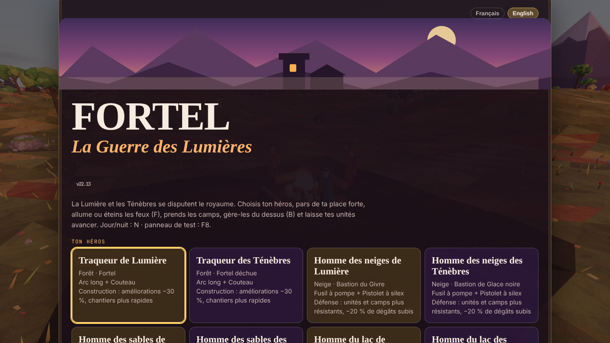

# FORTEL — La Guerre des Lumières

A first-person 3D action-strategy game that runs entirely in the browser: one HTML file, no install.

Light and Darkness fight over the kingdom. Pick a hero, leave your stronghold, light or put out the fires, capture camps, manage them from above and send your units forward.

## ▶️ Play

**[Play in the browser](https://t800lostinhumanity-svg.github.io/fortel/)** — designed for a PC with a graphics card, keyboard + mouse or gamepad.

## Features

- **8 heroes, 4 biomes, 2 sides** — forest, snow, desert and lake, each in a Light and a Darkness version, each with its own weapons and bonus (building, defence, speed, trade)
- **FPS + strategy**: shoot and fight in first person, then switch to a top-down view (B) to manage camps and units
- **Day / night cycle**, fires to light or put out, contracts that change every day in the towns
- **AI opponent** in 3 difficulty levels
- **Progression**: hero talents, origins (Veteran, Builder, Merchant…), game modifiers, sandbox and hardcore modes
- **Accessibility**: colour-blind mode, interface size, reduced effects, minimal HUD, touch controls, French / English
- **Performance profiles**: automatic quality, dynamic resolution, draw distance
- Keyboard (AZERTY or QWERTY), mouse and gamepad support

## Controls (main)

| Key | Action |
|---|---|
| Z Q S D / W A S D | Move |
| Mouse / click | Aim / shoot · strike |
| Right click | Scope · parry arrows at the right moment |
| Space · Shift · Alt | Jump · sprint · roll |
| F | Light / put out a fire |
| B | Top-down management view |
| G | Your units follow you |
| N | Day / night |
| Tab | Map |
| K | Hero talents |

The full list is on the title screen.

## Tech

- **Three.js** (WebGL) with post-processing (bloom), low-poly procedural world and characters
- Pure **JavaScript / HTML / CSS**, no build step, no backend
- Built through **AI-assisted development** ("vibe coding") with Claude: game design, art direction and iteration driven by me, code generated and refined with the AI

## Online features

The original version runs as a Claude artifact on claude.ai, where it can also use **online multiplayer, cloud saves and screenshot downloads**. On GitHub Pages these features switch off automatically and the game runs in **solo**.

---

**Author:** Antoine Ricci — Systems & Network Technician in training, AI × cybersecurity · [LinkedIn](https://www.linkedin.com/in/antoine-ricci-389471452/)

🇫🇷 *Jeu d'action-stratégie 3D à la première personne, jouable directement dans le navigateur. Conçu et itéré avec l'IA (Claude).*
